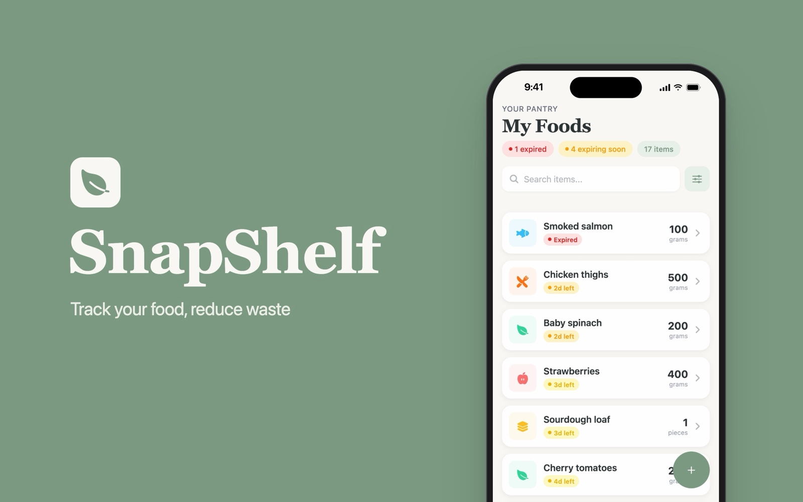
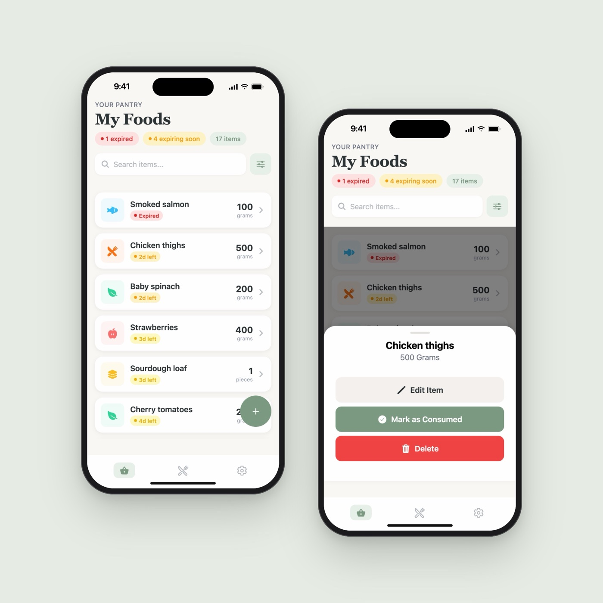
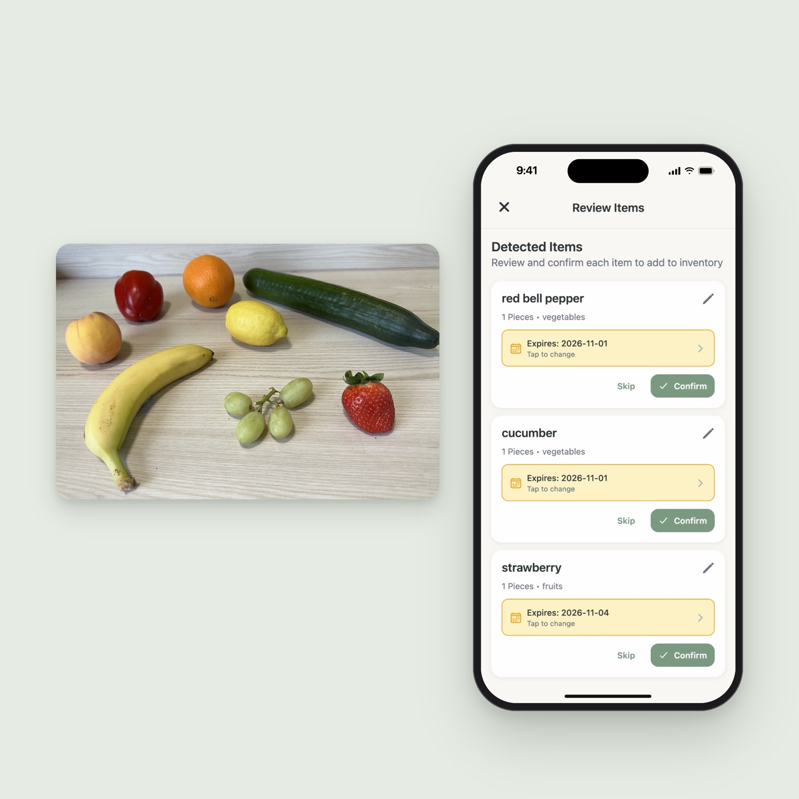
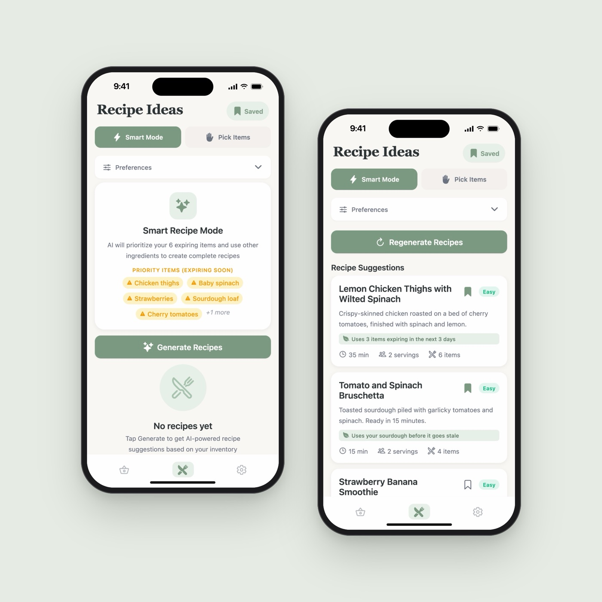
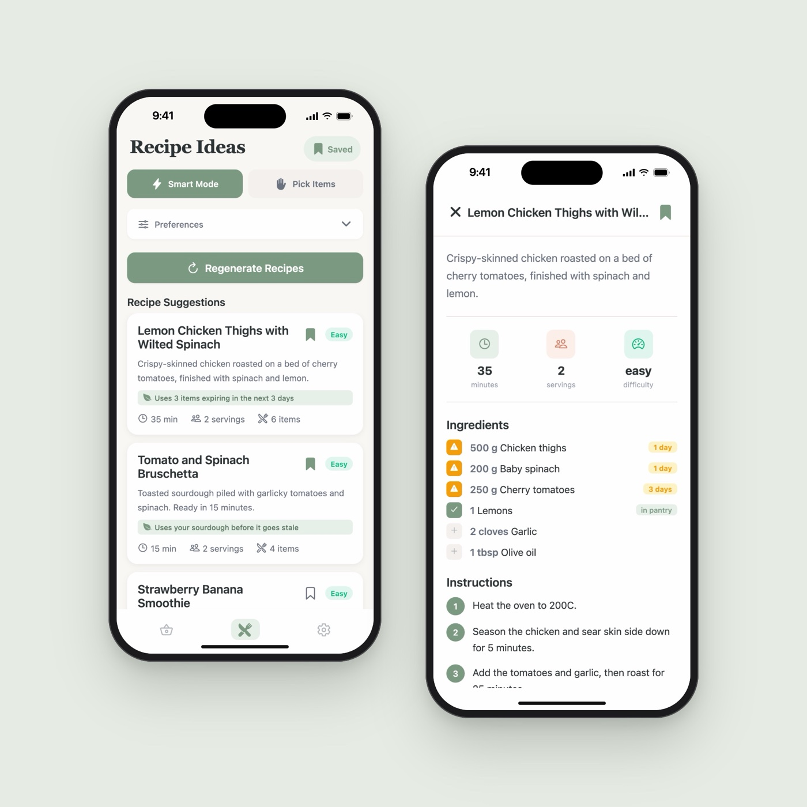
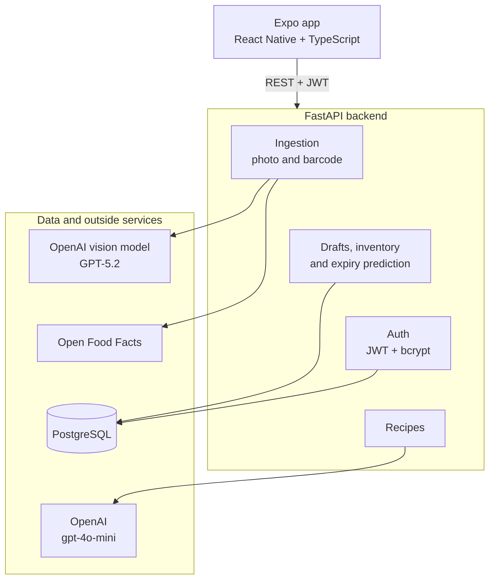
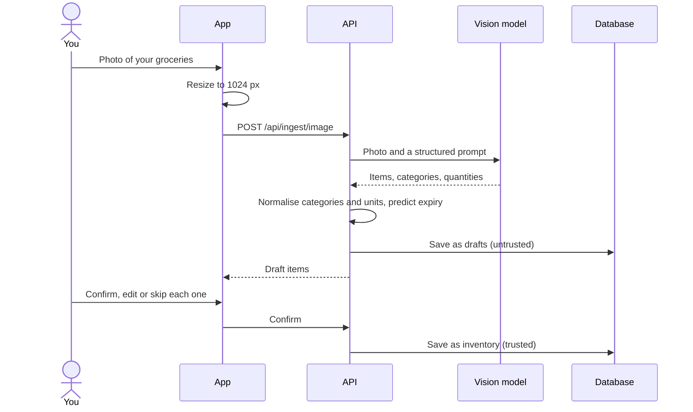
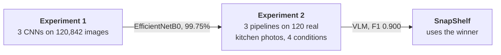
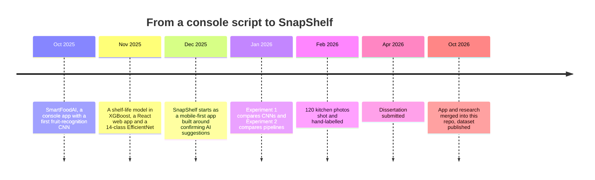

# SnapShelf

**Snap a photo of your groceries and SnapShelf fills in your kitchen inventory, tells you what is
about to go off, and suggests what to cook with it.**

[](api/)
[](api/)
[](mobile/)
[](https://huggingface.co/datasets/omorros/kitchen-fruit-vegetable-detection)

Most food waste at home happens because people forget what they have, and inventory apps fail
because typing everything in is too much work. SnapShelf removes the typing: a photo, a barcode,
or a few taps. The AI's suggestions land in a review list first, so nothing enters your inventory
without your yes.

This repo holds the app and the research behind it. Before choosing how the app should read a
photo, I compared three computer vision pipelines on photos from a real kitchen, as my BSc
dissertation. The winner, a vision-language model, is what the app uses.

| | |
|---|---|
|  |  |
|  |  |

## What it does

- **Scan a photo** of your shopping or fridge. A vision model lists each item with its category,
  quantity and a predicted expiry date.
- **Scan a barcode** and the product is looked up on Open Food Facts.
- **Review before it counts.** Every detected item is a draft you confirm, edit or skip.
- **See what is about to go off.** The inventory is sorted by expiry and colour-coded, with
  counts of expired and expiring-soon items, search and filters.
- **Use things up.** Mark part of an item as used, swipe to edit or delete.
- **Cook what is expiring.** Recipe ideas built around the items closest to their date, or around
  ingredients you pick. Save the ones you like.

## How it works



### AI suggests, you decide

A vision model can be confidently wrong, so nothing it says is trusted until you confirm it.



Drafts may have missing fields and carry a confidence score. Inventory items have every field
filled in, and the only way to create one is to confirm a draft. More in the [API README](api/).

## The research

Which pipeline should read the photo? I tested that before building on it.



| Pipeline | F1, clean photos | Worst F1 drop under blur, noise or JPEG | Time per photo |
|---|---|---|---|
| **Vision-language model (GPT-5.2)** | **0.900** | **0.034** | 2.3 to 10.7 s |
| YOLOv8s, 14 classes | 0.603 | 0.350 | 0.2 to 0.5 s |
| YOLOv8s + EfficientNetB0 | 0.547 | 0.180 | 0.9 to 1.3 s |

- A classifier that scored **99.75% on studio images** sat inside the weakest pipeline on real
  kitchen photos.
- The VLM stayed accurate under heavy noise that broke YOLO, and **all of its false positives
  were grapes**: the labels count a bunch as one, the model counted berries.
- YOLO is far faster and works offline, so it remains the right choice when there is no network.

The full write-up, with research questions, figures and limitations, is in
[**research/**](research/).

### The dataset

The 120 test photos are published on Hugging Face as
[**Kitchen Fruit & Vegetable Detection**](https://huggingface.co/datasets/omorros/kitchen-fruit-vegetable-detection):
585 hand-drawn boxes across 14 classes, with location, difficulty and camera-angle metadata, in
COCO and YOLO formats, under CC BY 4.0.

## Run it

**Backend** (tested on Python 3.13):

```bash
cd api
python -m venv .venv && source .venv/bin/activate
pip install -r requirements.txt
cp .env.example .env      # DATABASE_URL, JWT_SECRET_KEY, OPENAI_API_KEY
uvicorn app.main:app --reload --host 0.0.0.0 --port 8000
```

**App** (Node 20 or newer):

```bash
cd mobile
npm install --legacy-peer-deps
cp .env.example .env      # EXPO_PUBLIC_API_URL
npx expo start
```

**Tests:**

```bash
pytest                                  # 52 backend tests, no database or API key needed
cd mobile && npx tsc --noEmit           # type-check the app
```

Details: [api/README.md](api/) and [mobile/README.md](mobile/).

## Repository

```
SnapShelf/
├── api/                          FastAPI backend and its tests
├── mobile/                       Expo app
├── research/
│   ├── 01-cnn-comparison/        Experiment 1: notebooks and figures
│   └── 02-pipeline-comparison/   Experiment 2: pipelines, evaluation, YOLO training
└── docs/                         product requirements and images
```

## How it came together



The original plan was one custom CNN, a regression model for expiry dates and receipt OCR.
Vision-language models improved so quickly during the literature review that the better question
became which approach to build on at all, so the project turned into a fair comparison, and the
app ships the winner.

## Built with

**App:** React Native, Expo, Expo Router, TypeScript. **Backend:** FastAPI, SQLAlchemy,
PostgreSQL, Pydantic, JWT. **AI:** OpenAI GPT-5.2 (vision) and gpt-4o-mini (recipes).
**Research:** TensorFlow and Keras, Ultralytics YOLOv8, OpenCV, scikit-learn, Google Colab.

---

Built by [Oriol Morros Vilaseca](https://omorros.com). The code is all rights reserved; the
dataset is CC BY 4.0.
