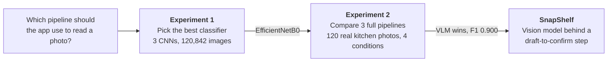
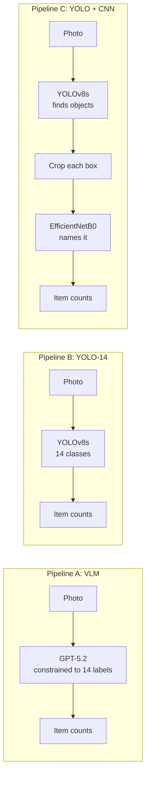
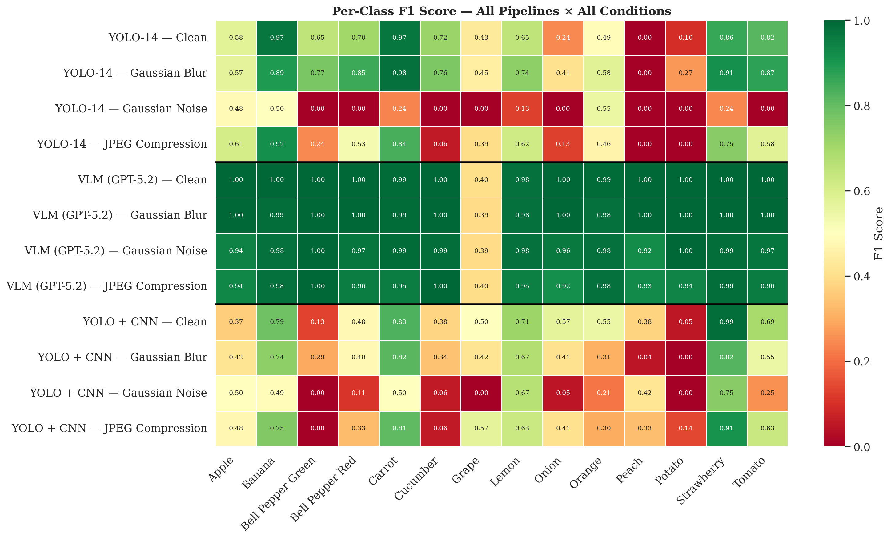

# The research behind SnapShelf

SnapShelf only works if adding food is effortless, so the app has to read a photo of your
groceries and list what is in it. This research asked **which kind of computer vision pipeline
does that best**: a trained image classifier, an object detector, or a general vision-language
model (VLM). It was my BSc (Hons) Software Engineering dissertation at Anglia Ruskin University
(2026), *Reducing Household Food Waste through Automated Produce Recognition: A Comparative
Evaluation of Vision-Language, Object Detection and Hybrid Computer Vision Pipelines*.

The project began as a plan for a single custom CNN. While reviewing the literature, VLMs
improved so quickly that the better question became which approach to build on at all, so the
study was re-scoped into a fair comparison with the app as the place the winner would ship.

## How the experiments connect

| | Question | Answer |
|---|---|---|
| RQ1 | Which CNN gives the best accuracy-efficiency trade-off for 14-class produce classification? | **EfficientNetB0**: 99.75%, statistically tied with ResNet-50 (99.77%) at 5.3x smaller |
| RQ2 | Which pipeline reaches the highest count-based F1 on a real inventory task? | **The VLM (GPT-5.2)**: F1 0.900, against 0.603 for YOLOv8 and 0.547 for YOLO + EfficientNet |
| RQ3 | How robust is each pipeline to blur, noise and JPEG compression? | **The VLM**: its worst drop is 0.034, against 0.180 for the hybrid and 0.350 for YOLO |
| RQ4 | What does deploying the winner cost in latency, money and offline use? | 2.3 to 10.7 s and about $0.004 per photo, and it needs a network. YOLO is 10 to 50x faster and works offline |

## Experiment 1: which classifier

[`01-cnn-comparison/`](01-cnn-comparison/)

A custom CNN, EfficientNetB0 and ResNet-50 trained under one protocol on 120,842 fruit and
vegetable images. I merged three Kaggle datasets, removed 42,474 exact duplicates by hashing
every file (9,263 of them across sources), and split 70/15/15 with no leakage of identical files.

| Model | Test accuracy | Parameters | Size | Errors (of 18,141) |
|---|---|---|---|---|
| Custom CNN | 98.34% | 4.96M | 56.9 MB | 301 |
| EfficientNetB0 | 99.75% | 4.07M | 40.0 MB | 46 |
| ResNet-50 | 99.77% | 24.13M | 211.0 MB | 42 |

EfficientNetB0 and ResNet-50 are statistically tied (overlapping Wilson 95% intervals), so the
smaller model went forward.

## Experiment 2: which pipeline

[`02-pipeline-comparison/`](02-pipeline-comparison/)

All three ran on the same **120 photos I took in a real home**, designed shot by shot across five
locations, three difficulty levels and three camera angles, with 585 hand-drawn boxes. Each photo
was also degraded three ways, for a 12-run matrix. The test set is published as
[Kitchen Fruit & Vegetable Detection](https://huggingface.co/datasets/omorros/kitchen-fruit-vegetable-detection).

| Condition | VLM (GPT-5.2) | YOLO-14 | YOLO + CNN |
|---|---|---|---|
| Clean | **0.900** | 0.603 | 0.547 |
| Gaussian blur | **0.895** | 0.655 | 0.495 |
| Gaussian noise | **0.878** | 0.253 | 0.367 |
| JPEG quality 5 | **0.866** | 0.512 | 0.517 |

Before Pipeline A was fixed, three VLMs were compared with the same prompt: GPT-5.2 (F1 0.900),
Gemini 3.1 Pro (0.904) and Claude Opus 4.6 (0.867). GPT-5.2 was chosen for being 2.4x faster
and 2.7x cheaper than Gemini for nearly the same accuracy.

## What I learned

- **99.75% in the lab is not 99.75% in a kitchen.** The same EfficientNetB0 that was nearly
  perfect on studio images was part of the weakest pipeline on real photos (F1 0.547). The
  Kaggle data is mostly clean, centred, near-duplicate frames; real counters are not.
- **The VLM's errors were mostly about the labels, not vision.** All 126 of its false positives
  on clean photos were grapes: my labels count a bunch as one item, and the model counted
  berries. Without grapes it scores F1 0.997.
- **Robustness separated the pipelines more than accuracy did.** Under heavy noise YOLO's F1
  fell from 0.603 to 0.253 while the VLM lost 0.022.
- **YOLO got better under blur** (0.603 to 0.655). Blurring a 12 MP photo before YOLO shrinks it
  to 640 px seems to act like smoothing, pulling the photos closer to its training data.
- **The best model still needs a safety net.** A VLM can be confidently wrong, so in SnapShelf
  everything it detects lands as a draft, and nothing reaches your inventory until you confirm it.

## Limitations

- **A small, single-source test set:** 120 photos, one home, one phone, one photographer and
  annotator. The VLM's lead over YOLO is large enough to survive that; the gap between GPT-5.2
  and Gemini is not.
- **An undertrained YOLO baseline:** a 47-to-14 class remap, an untuned confidence threshold and
  heavy class imbalance (peach had 29 validation instances). Typical fine-tuned YOLOv8 scores
  are well above 0.603.
- **Uneven training data:** the VLM has seen the internet; the specialists saw public datasets.
  The result is about which option you can deploy today, not which architecture is better.
- **Experiment 1's data is easy:** near-duplicate video frames make 99.7% optimistic.
- **A fixed prompt:** the VLM prompt was never iterated, so 0.900 is a floor. One rule about
  grape bunches would likely raise it.
- **Timing and cost are rough:** latency includes file decoding and upload, and was measured on
  one machine.

## What I would do next

1. A larger test set with several photographers and annotators, for tighter confidence intervals.
2. Fine-tune YOLO on a small in-domain set, rebalance its classes, and train it with blurred images.
3. Apply degradations at each model's input resolution, and add significance tests.
4. Replace the rule-based expiry estimates with a model trained on real consumption data.
5. A user study of the draft-to-confirm flow in everyday use.

## Reproducing

Each experiment folder has its own README with setup and run steps. Experiment 1 runs as Colab
notebooks; Experiment 2 is a Python CLI (`python main.py evaluate ...`) and fetches its test
photos with `python scripts/download_dataset.py`. Trained weights and the Kaggle-derived
training data are not in this repo.
